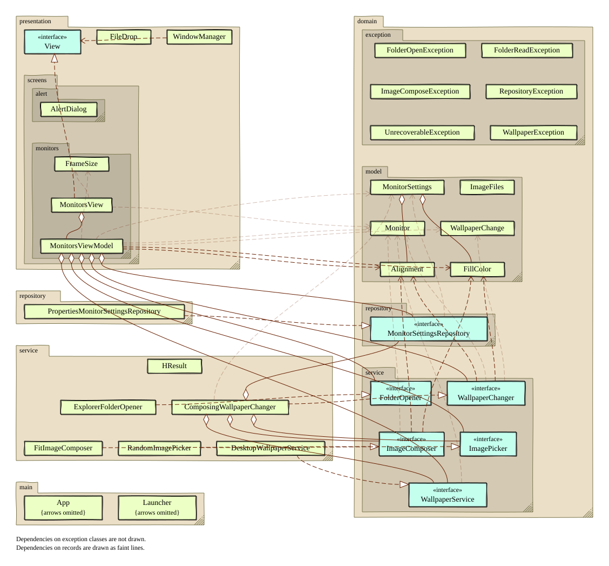

# sss-wallpaperの設計

この文書は、sss-wallpaperの今の設計を説明します。設計が変わったら、この文書も書き換えます。なぜそう決めたかは、ADR（`docs/adr/`）に書きます。

## 全体像

sss-wallpaperは、Windowsのモニターごとに別の壁紙を設定するJavaFXアプリです。

起動のしかたは2つあります。

- **ウィンドウあり：** 普通に起動すると、モニターの一覧の画面を開きます。
- **ウィンドウなし：** `--randomize`を付けて起動すると、画面を開きません。全モニターの壁紙をランダムに変えて、すぐに終了します。

画面は1つだけです。

| 画面 | クラス | 内容 |
|---|---|---|
| モニターの一覧 | `MonitorsView` | モニターごとの枠を、実際の並びと大きさの比率で横に並べる。枠には現在の壁紙のサムネイル、フォルダ名か画像名、「Open location」ボタン、寄せ方と埋める色のComboBoxがある。上に「Randomize all」ボタンがある |

ウィンドウは`StageStyle.EXTENDED`で開きます。OSのタイトルバーは出ません。代わりに、各画面が`HeaderBar`を描き、その左にタイトルを置きます。`View`の`stageStyle()`の既定値が`EXTENDED`なので、新しい画面もこの形になります。

## レイヤーとパッケージ

構成はMVVMです。AppModelはありません。共有する状態がまだないためです。

画面のPropertyを持たない処理は、サービスに置きます。たとえば、壁紙を作って設定する手順と、ランダム変更の手順は`WallpaperChanger`にあります。`MonitorsViewModel`は、画面の状態だけを持ちます。

| パッケージ | 役割 | 主なクラス・インタフェース |
|---|---|---|
| `domain.model` | ドメインモデル | `Monitor`（IDと位置と大きさ）、`MonitorSettings`（モニターごとの設定）、`Alignment`（寄せ方）、`FillColor`（埋める色）、`ImageFiles`（画像の拡張子の判定）、`WallpaperChange`（変えた壁紙。モニターのID、元の画像、壁紙） |
| `domain.service` | サービスのインタフェース | `WallpaperService`（モニターの列挙、壁紙の設定と取得）、`WallpaperChanger`（壁紙を作って設定する、ランダム変更）、`ImageComposer`（壁紙の画像の合成）、`ImagePicker`（フォルダから1枚を選ぶ）、`FolderOpener`（フォルダをOSのファイルマネージャーで開く） |
| `domain.repository` | リポジトリのインタフェース | `MonitorSettingsRepository`（設定の読み書き） |
| `domain.exception` | ドメイン例外 | `UnrecoverableException`と、その子の`WallpaperException`、`ImageComposeException`、`FolderReadException`、`FolderOpenException`、`RepositoryException` |
| `service` | サービスの実装 | `ComposingWallpaperChanger`、`DesktopWallpaperService`、`HResult`、`FitImageComposer`、`RandomImagePicker`、`ExplorerFolderOpener` |
| `repository` | リポジトリの実装 | `PropertiesMonitorSettingsRepository` |
| `presentation` | 画面の共通部品 | `View`、`WindowManager` |
| `presentation.screens.alert` | 共通のダイアログ | `AlertDialog`（エラーダイアログ） |
| `presentation.screens.monitors` | モニターの一覧の画面 | `MonitorsView`、`MonitorsViewModel`、`FrameSize`（枠の大きさ） |
| `main` | 起動とコンポジションルート | `Launcher`（`main`メソッド）、`App`（`Application`の子クラス） |

依存の向きは、`presentation` → `domain`の一方向です。`service`と`repository`は、`domain`のインタフェースを実装します。`domain`は、ほかのパッケージに依存しません。

`MonitorsViewModel`は、5つのインタフェースをコンストラクタで受け取ります。具体的なクラスを組み立てるのは、`App.createMonitorsViewModel()`と`App.createWallpaperChanger()`だけです。テストでは、`NullWallpaperService`などのテスト用の実装に差し替えます。

クラスの関係は、次のクラス図で見られます。

この図は、classdiagram-maven-pluginがビルドのたびに描き直します。`compile`フェーズで、コンパイラーの後に動きます。手で編集しないでください。

## 外部とのやり取り

### Windowsの壁紙のAPI

`DesktopWallpaperService`が、WindowsのCOMの`IDesktopWallpaper`を、FFM API（`java.lang.foreign`）で直接呼びます。使うメソッドは次のとおりです。

| メソッド | 用途 |
|---|---|
| `GetMonitorDevicePathCount`、`GetMonitorDevicePathAt` | モニターの列挙 |
| `GetMonitorRECT` | モニターの位置と大きさ。デスクトップから外れたモニターは、ここで失敗するので一覧から除く |
| `SetWallpaper` | 壁紙の設定 |
| `GetWallpaper` | 現在の壁紙の取得 |

モニターのIDは、Windowsが返すデバイスパスです。設定ファイルのキーにも、このIDを使います。

COMの呼び出しが失敗すると（HRESULTが負）、`HResult.check`が`WallpaperException`を投げます。

実装に必要なGUIDやvtableの並びと、その調べ方は、ADR 1にあります。

### 合成した壁紙の画像

Windowsの「Fit」は、画像を常に中央に置きます。左寄せや右寄せにするために、`FitImageComposer`がモニターと同じ大きさの画像をアプリで合成します。Windowsには、合成した画像を設定します。

- 元の画像を、縦横比を保ってモニターに収まる大きさに縮めます。
- 寄せ方に従って左か右に置き、縦は中央に置きます。
- 余白は、白か黒で埋めます。
- 保存先は`~/.sss-wallpaper/wallpapers/`です。
- ファイル名は`monitor-<IDのハッシュ>-<時刻>.png`です。合成のたびに名前を変えます。同じモニターの古い画像は、新しい画像を保存する前に消します。

### 設定ファイル

`PropertiesMonitorSettingsRepository`が、モニターごとの設定をJavaのProperties形式で保存します。

- 場所は`~/.sss-wallpaper/settings.properties`です。システムプロパティ`sss.settings.file`で変えられます。テストはこれで一時フォルダに向けます。
- 文字コードはUTF-8です。
- キーは`<モニターID>.<項目>`です。

| キー | 値 |
|---|---|
| `<ID>.folder` | 登録したフォルダのパス。ないときはキーがない |
| `<ID>.image` | 最後に壁紙にした元の画像のパス。ないときはキーがない |
| `<ID>.alignment` | `LEFT`または`RIGHT` |
| `<ID>.fill` | `WHITE`または`BLACK` |

読み込むときは、`.alignment`のキーでモニターを見つけます。

## 主な処理の流れ

### ウィンドウありの起動

1. `Launcher.main`が、`--randomize`がないことを確かめて、`Application.launch(App.class)`を呼びます。
2. `App.start`が、AtlantaFXの`PrimerLight`テーマを適用します。
3. `App.createMonitorsViewModel()`で、サービスとリポジトリを組み立てます。
4. `MonitorsView`を`WindowManager`に登録し、ウィンドウを開きます。
5. `MonitorsViewModel.loadMonitors()`を呼びます。
   1. `WallpaperService.listMonitors()`でモニターを取り、x座標の順に並べます。
   2. 各モニターの現在の壁紙を`getWallpaper`で取ります。
   3. 設定ファイルを読み、各モニターの設定を戻します。戻している間は、設定の変更で壁紙を作り直したり、保存したりしません。
   4. 枠の縮尺を決めます。枠の合計の幅が960px以内で、かつ最大でも1/8になるようにします。
   5. モニターの一覧を更新します。`MonitorsView`がこれを購読していて、枠を作り直します。

### ウィンドウなしの起動（`--randomize`）

1. `Launcher.main`が、`App.createWallpaperChanger()`で`WallpaperChanger`だけを作ります。JavaFXは起動しません。ViewModelも作りません。
2. `WallpaperChanger.randomizeAll()`を呼びます。処理は「ランダム変更」と同じです。
3. `UnrecoverableException`が起きたら、メッセージを標準エラー出力に書き、終了コード1で終わります。

### 画像やフォルダのドロップ

`MonitorsView`が、枠に落とされたファイルを`MonitorsViewModel.dropFiles`に渡します。

- **フォルダのとき：** そのモニターのフォルダとして登録します。`RandomImagePicker`がフォルダの直下から画像を1枚選びます。設定を保存してから、その画像で壁紙を作ります。画像がなければ、壁紙は変えません。
- **画像のとき：** フォルダの登録を外します。設定を保存してから、その画像で壁紙を作ります。
- 複数のファイルが落とされたときは、最初に当てはまった1つだけを使います。

壁紙を作る処理（`WallpaperChanger.change`）は、次の順に進みます。

1. `FitImageComposer.compose`で画像を合成します。
2. `DesktopWallpaperService.setWallpaper`で、Windowsに設定します。
3. 合成した画像を返します。ViewModelは、自分の現在の壁紙をこの画像に変えます。`MonitorsView`がこれを購読していて、サムネイルを背景で読み込みます。

### ランダム変更

「Randomize all」ボタンで`MonitorsViewModel.randomizeAll()`を呼びます。ViewModelは`WallpaperChanger.randomizeAll()`に任せます。

1. モニターの一覧と、設定ファイルを読みます。
2. フォルダを登録した各モニターで、フォルダから画像を1枚選びます。
3. 選べたモニターが1つもなければ、何もしません。
4. 選んだ画像を元の画像として、設定を保存します。
5. 左のモニターから順に、壁紙を作ります。
6. モニターごとに、元の画像と壁紙を返します。ViewModelは、この結果で自分の状態を更新します。

### 場所を開く

枠の「Open location」ボタンで`openLocation()`を呼びます。

- フォルダを登録したモニターでは、そのフォルダを開きます。
- フォルダがなく、元の画像があるモニターでは、画像のあるフォルダを開きます。
- どちらもないモニターでは、ボタンを押せません。

`ExplorerFolderOpener`が`explorer.exe`を起動して開きます。起動できないときは`FolderOpenException`を投げます。

### 寄せ方や埋める色の変更

ComboBoxとViewModelのPropertyは、双方向にバインドしています。値が変わると、ViewModelの購読が動きます。設定を保存し、最後に使った元の画像で壁紙を作り直します。

## エラーの扱い

回復できないエラーは、`UnrecoverableException`の子クラスで表します。

- ウィンドウなしの起動では、`Launcher`がメッセージを出して終了コード1で終わります。
- ウィンドウありの起動では、`App.start()`の冒頭で、FXスレッドの未捕捉例外のハンドラを登録します。ドロップ、ComboBoxの変更、ランダム変更、場所を開く、のどれで起きた例外も、このハンドラに届きます。
  - `UnrecoverableException`なら、`AlertDialog.showError`で、そのメッセージのダイアログを出します。
  - それ以外の例外はバグです。スタックトレースを標準エラー出力に書いてから、`AlertDialog.showUnexpectedError`で、スタックトレースのダイアログを出します。
  - ダイアログを閉じても、アプリは続きます。
- 起動時の`loadMonitors()`は`App.start()`の中で呼ぶので、例外がハンドラに届きません。そのため、`try/catch`で`UnrecoverableException`を捕まえて、同じダイアログを出します。ウィンドウは開いたままです。

## 関連する文書

- ADR
  - [ADR 1: IDesktopWallpaper COM via FFM API](adr/adr-001-idesktopwallpaper-via-ffm.md)
- クラス図：[classdiagram.svg](classdiagram.svg)（ビルドで自動生成）
- リアクティブな依存の図：[reactive-dependencies.png](reactive-dependencies.png)（元のファイルは`reactive-dependencies.drawio`）
- ストーリーマップ：[storymap.md](storymap.md)
